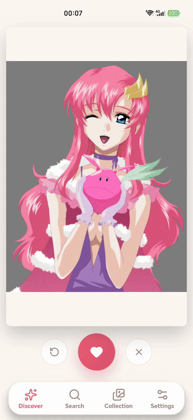
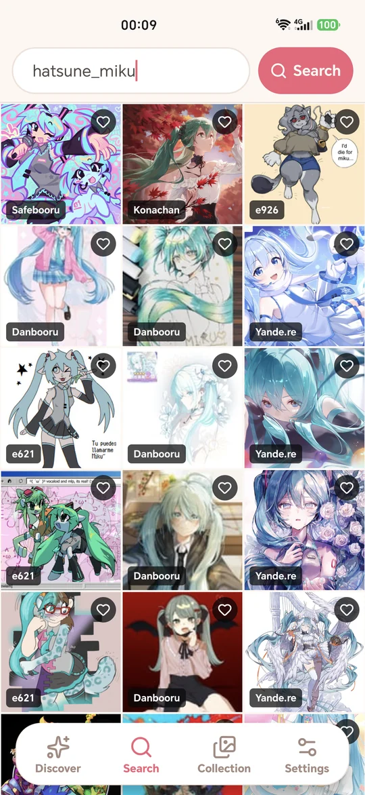
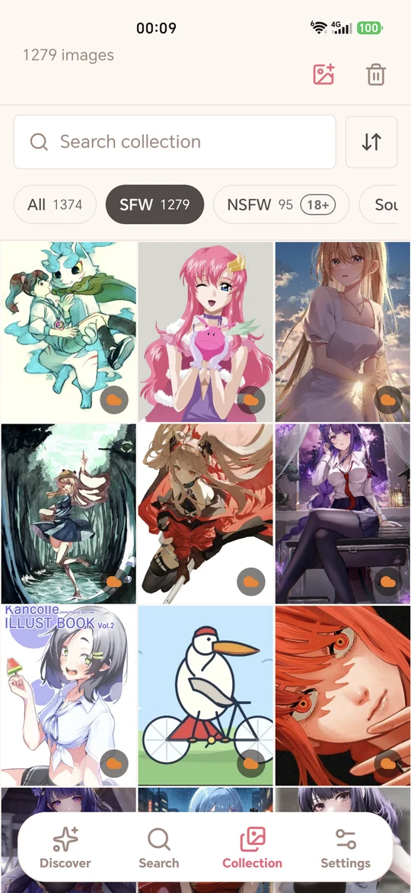
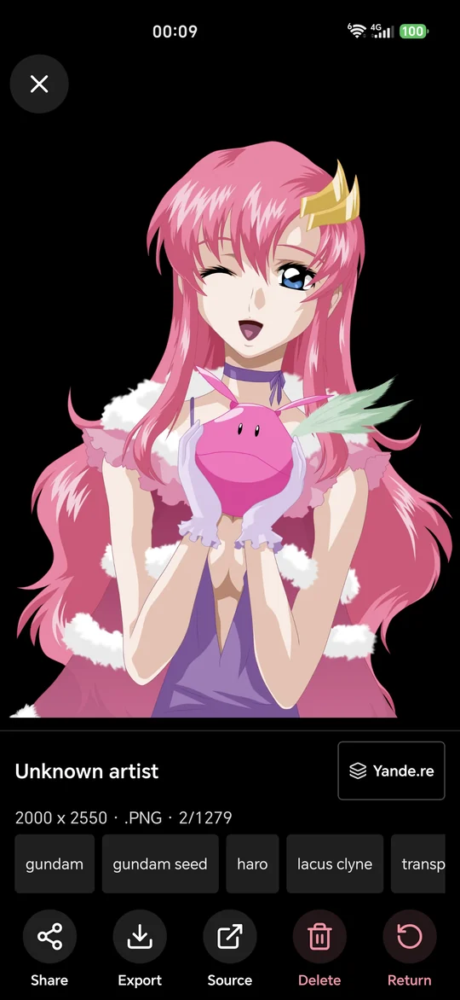
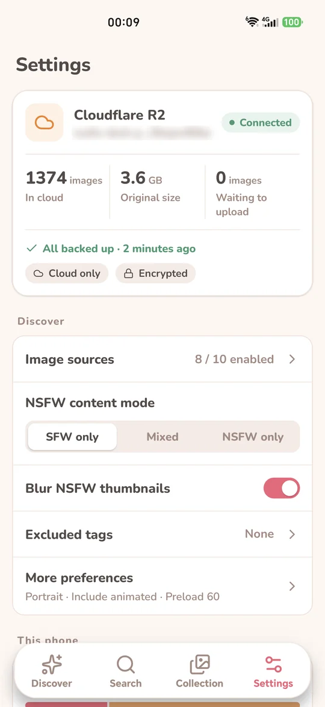

<div align="center">


# Waifu Deck

**一副牌，刷遍十个二次元图源。喜欢的留下，存在你的手机和你自己的云里。**

[](https://waifudeck.app/api/app/download)

[](LICENSE)
[](https://github.com/fancydirty/waifu-deck/actions/workflows/ci.yml)


[**下载 APK**](https://waifudeck.app/api/app/download) · [官网](https://waifudeck.app/zh/) · [隐私政策](https://waifudeck.app/privacy) · [English](README.md)



</div>

## 为什么做 Waifu Deck

大多数看图应用只接一个站，要你注册账号，原帖一删，收藏就跟着没了。Waifu Deck 反过来做：

- 🃏 **一副牌，十个图源。** Danbooru、yande.re、Konachan、Safebooru、waifu.im、Nekos API、Gelbooru、Rule34、e621、e926 混在同一个滑卡流里，不会被某一个站刷屏；同一张图发在好几个站上，通常也只出现一次。
- ✋ **右滑留下，左滑永不再见。** 每次选择都会记住，跳过的图重启后也不会回来。滑错了？撤回一下。
- 📁 **存原图，不存链接。** 收藏的图以原始分辨率下载到应用私有空间。源站删帖了，你手里的还在。
- ☁️ **可选同步到你自己的存储。** Cloudflare R2、Backblaze B2、Bunny、任意 S3 桶、Google Drive、OneDrive 或 WebDAV NAS。连同一个存储的每台手机，看到的是同一个图库。
- 🔒 **隐私是默认值。** 不要账号，没有广告，没有统计，中间也没有我们的服务器。

## 截图

<p align="center">
  
  
  
  
</p>
<p align="center"><sub>搜索 · 收藏 · 大图 · 云端图库（截图为英文界面，应用会跟随系统语言）</sub></p>

## 功能

**发现**
- 滑卡支持撤回，也有收藏和跳过按钮
- 在所有已开启的图源里按标签搜索，常见标签用中文名也能搜
- 内容模式：仅 SFW（默认）、混合、仅 NSFW。切到成人内容前需要确认已满 18 岁
- 排除标签、图片方向、是否包含动图

**收藏**
- 即时搜索，按分级和图源筛选，按时间、分辨率或文件大小排序
- 从手机相册导入自己的图片
- 分享、导出到相册，或打开原帖
- NSFW 缩略图可选模糊

**留得住**
- `.waifudeck` 完整备份文件，含设置、历史和原图
- 应用内检查更新，新版本直接覆盖安装，图库不丢
- **仅云端** 模式：手机只留缩略图，打开时再从你的存储取原图

**语言：** 简体中文、繁體中文、English、日本語，跟随系统语言。

## 安装

1. 从 **[waifudeck.app](https://waifudeck.app/api/app/download)** 下载签名 APK。
2. 打开安装；如果 Android 提示，允许浏览器或文件管理器安装应用。
3. 开始滑。没有要设置的，也没有要登录的。

需要 Android 7.0 及以上、64 位 ARM 手机。Waifu Deck 不在 Google Play 上架，有新版本时应用会提醒你。每个 [GitHub Release](https://github.com/fancydirty/waifu-deck/releases) 也附有同一个 APK，可以用 [Obtainium](https://github.com/ImranR98/Obtainium) 跟踪更新。

<a href="https://apps.obtainium.imranr.dev/redirect?r=obtainium://app/%7B%22id%22%3A%22app.waifudeck.mobile%22%2C%22url%22%3A%22https%3A%2F%2Fgithub.com%2Ffancydirty%2Fwaifu-deck%22%2C%22author%22%3A%22fancydirty%22%2C%22name%22%3A%22Waifu%20Deck%22%7D"></a>

## 图源

| 图源 | 内容 | 备注 |
| --- | --- | --- |
| [Danbooru](https://danbooru.donmai.us) | SFW + NSFW | |
| [yande.re](https://yande.re) | SFW + NSFW | 高清扫图 |
| [Konachan](https://konachan.net) | SFW | 壁纸尺寸 |
| [Safebooru](https://safebooru.org) | SFW | |
| [waifu.im](https://www.waifu.im) | SFW + NSFW | |
| [Nekos API](https://nekosapi.com) | SFW + NSFW | |
| [Gelbooru](https://gelbooru.com) | SFW + NSFW | 需填你自己的免费 API key |
| [Rule34](https://rule34.xxx) | 仅 NSFW | 需填你自己的免费 API key |
| [e621](https://e621.net) | SFW + NSFW | 兽人（furry）向 |
| [e926](https://e926.net) | SFW | 兽人（furry）向 |

每个图源都可以单独开关。图片在使用时从图源获取，不随应用打包。所有作品版权归原作者；只要图源提供了原帖地址，大图页就能一键跳回原帖。

## 云同步（自带存储）

同步是可选的，不开也是完整的应用。

| 存储 | 连接方式 |
| --- | --- |
| Cloudflare R2、Backblaze B2、Bunny Storage | 粘贴一个 API key，其余应用自己搞定（[二十秒视频教程](https://waifudeck.app/zh/keys/)） |
| 其他 S3 兼容存储（MinIO、Wasabi 等） | Endpoint、桶名、Access Key、Secret |
| Google Drive、OneDrive | 登录即可；应用只能访问它自己的文件夹 |
| WebDAV（群晖、Nextcloud 等 NAS） | `https` 地址、用户名和密码 |

- **在手机上加密。** 上传前用你的密码派生的密钥加密（scrypt、AES-GCM），存储服务商拿到的只是看不懂的文件。Google Drive、OneDrive 和 WebDAV 始终加密；用自己的 S3 桶时可以选择关闭加密。
- **密码无法找回。** 忘了密码，谁都恢复不了，包括我们。请记下来。
- **多台手机，一个图库。** 另一台手机连同一个存储、输入同一个密码即可。缩略图先到，原图在后台陆续下载。

各存储的实测数据和接入细节（英文）见 [docs/storage-backends.md](docs/storage-backends.md)。

## 隐私

Waifu Deck 没有账号，也没有后端。它只连你开启的图源；如果你设置了同步，再加上你自己的存储。除此之外不连别的。完整内容见[隐私政策](https://waifudeck.app/privacy)。

## 常见问题

<details>
<summary><b>真的免费吗？</b></summary>

真的。以 AGPL-3.0 开源，没有广告，也没有付费档。我们没有存你图片的服务器，自然也没有账单要转嫁给你。
</details>

<details>
<summary><b>为什么不上 Google Play？</b></summary>

直接分发才能提供全部图源，包括应用商店不允许的成人内容源。每个版本都用同一把密钥签名，所以更新可以直接覆盖安装。
</details>

<details>
<summary><b>手机空间不够了怎么办？</b></summary>

先连上云存储，再把 **设置 → 这台手机** 改成 **仅云端**。手机只留小缩略图，打开某张图时才下载原图。
</details>

<details>
<summary><b>卸载会把收藏一起删掉吗？</b></summary>

会。卸载会清掉应用的私有存储。卸载前先导出 `.waifudeck` 备份或连上云存储，重新安装后用任意一种都能全部恢复。
</details>

## 从源码构建

需要 Node.js 24 或更新版本、JDK 17 和 Android SDK。应用基于 [Expo SDK 56](https://docs.expo.dev/versions/v56.0.0/) 和 React Native。

```bash
npm ci
npm run android    # 生成原生工程、构建，并安装到连接的手机或模拟器
```

提交改动前：

```bash
npm test
npm run typecheck
npm run lint
```

给贡献者的存储后端说明（英文）：[docs/storage-backends.md](docs/storage-backends.md)。

## 参与贡献

欢迎提 issue 和 PR，尤其欢迎新的图源和存储后端。较大的改动请先开 issue 商量方案，免得白费功夫。

## 许可证

Waifu Deck 以 [GNU Affero General Public License v3.0](LICENSE) 授权。

许可证只覆盖应用源代码，不授予对图源返回的图片或上方截图中作品的任何权利，这些作品版权归原作者所有。
